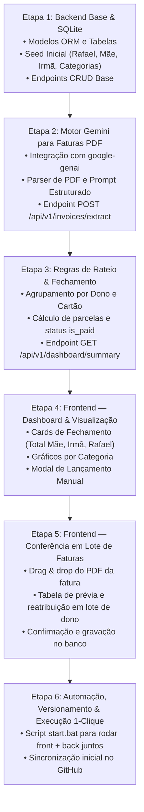

# 🏛️ Financial Organizer — Blueprint & Passo a Passo do Projeto

Este documento define a **estrutura final de diretórios**, a **arquitetura de componentes** e o **passo a passo detalhado de implementação** do aplicativo de controle financeiro familiar.

---

## 📁 Estrutura de Diretórios Final

```text
financial_organizer/
├── backend/                       # API REST em Python (FastAPI + SQLAlchemy)
│   ├── app/
│   │   ├── api/
│   │   │   └── v1/
│   │   │       ├── api.py         # Roteador central v1
│   │   │       └── endpoints/
│   │   │           ├── owners.py        # CRUD Donos (Rafael, Mãe, Irmã)
│   │   │           ├── cards.py         # CRUD Cartões de crédito
│   │   │           ├── categories.py    # CRUD Categorias de despesas
│   │   │           ├── transactions.py  # Lançamentos manuais e edição
│   │   │           ├── dashboard.py     # Consolidado mensal e rateio familiar
│   │   │           └── invoices.py      # Upload e extração de PDF via Gemini
│   │   ├── core/
│   │   │   ├── config.py          # Configurações com Pydantic-Settings
│   │   │   ├── database.py        # Engine assíncrono com SQLite (financial.db)
│   │   │   └── gemini.py          # Cliente e prompt multimodal do Gemini API
│   │   ├── db/
│   │   │   └── init_db.py         # Criação de tabelas e seed automático
│   │   ├── models/                # Modelos ORM (Owner, Card, Category, Transaction)
│   │   ├── schemas/               # Contratos Pydantic de entrada/saída
│   │   └── services/              # Regras de negócio, rateio e projeção de parcelas
│   ├── tests/                     # Testes automatizados (pytest e Playwright)
│   ├── requirements.txt           # Dependências Python
│   └── run.py                     # Inicializador do backend (porta 8000)
│
├── frontend/                      # Interface Web Moderna (React + Vite + Tailwind)
│   ├── src/
│   │   ├── components/
│   │   │   ├── ui/                # Componentes shadcn/ui (Button, Dialog, Card, etc.)
│   │   │   ├── dashboard/         # Cards familiares (Mãe, Irmã, Rafael) e gráficos
│   │   │   ├── transactions/      # Tabela de transações e modal de cadastro manual
│   │   │   ├── invoice-uploader/  # Upload de PDF e tela de conferência em lote
│   │   │   └── layout/            # Header, seletor de mês e navegação
│   │   ├── hooks/                 # Custom React hooks (TanStack Query)
│   │   ├── lib/
│   │   │   ├── api.ts             # Cliente HTTP para comunicação com o backend
│   │   │   └── formatters.ts      # Formatação de moedas (R$) e datas brasileiras
│   │   ├── types/                 # Tipos TypeScript espelhando os contratos da API
│   │   ├── App.tsx
│   │   └── main.tsx
│   ├── package.json
│   └── vite.config.ts             # Configurado na porta 5173
│
├── docs/                          # Documentações e diagramas
│   ├── SPEC.md
│   ├── DATA_MODEL.md
│   └── GEMINI_PDF_PIPELINE.md
│
├── ENV/                           # Chaves e tokens locais protegidos (.gitignore)
│   └── .env                       # GITHUB_TOKEN e API_KEY (Gemini)
│
├── .gitignore                     # Proteção de credenciais e arquivos temporários
├── .env.example                   # Modelo público de variáveis de ambiente
├── README.md                      # Apresentação do projeto e instruções de uso
└── start.bat                      # Script único para inicializar tudo em 1 clique
```

---

## 🧱 Arquitetura e Tecnologias

| Camada | Tecnologia | Motivo da Escolha |
| :--- | :--- | :--- |
| **Banco de Dados** | **SQLite Nativo (`financial.db`)** | Zero instalação de servidores. Portabilidade máxima: roda em qualquer computador sem Docker ou serviços de background. |
| **Backend** | **Python + FastAPI + SQLAlchemy 2.0** | Alta velocidade assíncrona, documentação Swagger automática em `/docs` e validação estrita com Pydantic v2. |
| **Inteligência Artificial** | **Google Gemini 2.0 / 1.5 Flash (`google-genai`)** | Extração multimodal estruturada de faturas PDF em segundos, detectando parcelas e sugerindo categorias e donos. |
| **Frontend** | **React 19 + TypeScript + Vite + Tailwind CSS** | Interface fluida e responsiva, componentizada com shadcn/ui e gráficos com Recharts. |

---

## 🗺️ Passo a Passo de Implementação (Roadmap do MVP)



---

### Detalhamento das Etapas:

#### 🔹 Etapa 1: Backend Base & SQLite
1. Criar ambiente virtual Python (`.venv`) e instalar dependências (`fastapi`, `uvicorn`, `sqlalchemy`, `aiosqlite`, `pydantic-settings`, `google-genai`, `python-multipart`).
2. Configurar `database.py` apontando para o SQLite local com engine assíncrono.
3. Criar os modelos SQLAlchemy:
   - `Owner` (`id`, `name`, `category`, `phone_number`).
   - `Card` (`id`, `card_name`, `payment_date`, `total_limit`).
   - `Category` (`id`, `description`).
   - `Transaction` (`id`, `dt_lcto`, `description`, `value`, `owner_id`, `card_id`, `type_id`, `total_parcs`, `cur_parcs`, `is_paid`, `comment`).
4. Criar o seed automático no startup:
   - Donos padrão: **Rafael**, **Mãe**, **Irmã**.
   - Categorias padrão: *Mercado*, *Lazer*, *Farmácia*, *Restaurante*, *Roupas*, *Assinaturas*, *Transporte*, *Outros*.

#### 🔹 Etapa 2: Motor Gemini para Faturas PDF
1. Ler a chave `API_KEY` do arquivo `ENV/.env` de forma transparente.
2. Criar serviço `gemini_invoice_parser.py` utilizando o SDK oficial do Google (`google-genai`).
3. Definir o schema Pydantic de saída para que o Gemini retorne uma lista de transações com data, descrição, valor, parcelas (ex: 2/10) e categoria sugerida.
4. Criar o endpoint `POST /api/v1/invoices/extract` que recebe o PDF e devolve os itens extraídos para conferência.

#### 🔹 Etapa 3: Regras de Rateio & Fechamento Familiar
1. Criar endpoint `GET /api/v1/dashboard/summary?month=YYYY-MM&card_id=X`:
   - Total geral da fatura.
   - Total atribuído à Mãe (com flag de pago/pendente).
   - Total atribuído à Irmã (com flag de pago/pendente).
   - Total atribuído ao Rafael.
   - Total por categoria.
2. Criar endpoint `PATCH /api/v1/transactions/{id}/toggle-paid` para dar baixa nos pagamentos.

#### 🔹 Etapa 4: Frontend — Dashboard & Visualização
1. Inicializar o frontend em React + TypeScript + Vite.
2. Criar os cards de fechamento destacados no topo da tela:
   - **Card Mãe:** Valor a pagar no mês + indicador de status + botão "Marcar como Pago".
   - **Card Irmã:** Valor a pagar no mês + indicador de status + botão "Marcar como Pago".
   - **Card Rafael:** Sua parcela na fatura.
3. Gráficos com Recharts mostrando os maiores grupos de despesa.
4. Modal para inclusão manual de lançamentos rápidos.

#### 🔹 Etapa 5: Frontend — Conferência em Lote de Faturas (O Ponto Alto)
1. Componente de upload para arrastar o PDF da fatura do banco.
2. Tabela interativa mostrando o que o Gemini extraiu.
3. Seletor rápido de dono em cada linha com opção de selecionar múltiplas linhas e aplicar o dono em lote (ex: selecionar 3 compras e definir "Mãe").
4. Botão "Salvar no Banco", persistindo tudo de uma só vez.

#### 🔹 Etapa 6: Automação & Execução em 1 Clique
1. Criar `start.bat` na raiz do projeto: ao dar duplo clique, ele sobe o backend FastAPI e o frontend Vite automaticamente.
2. Sincronizar o código com o repositório GitHub `https://github.com/Rafapsantoz/financial_control.git`.
