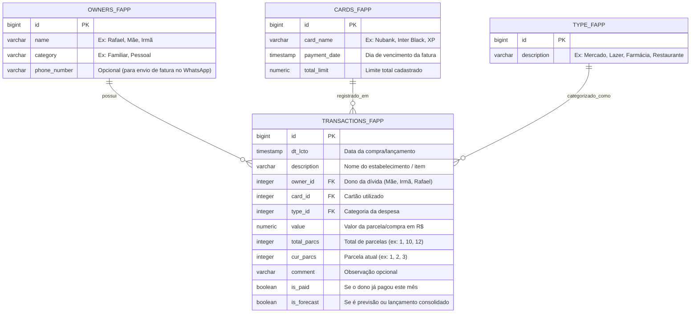

# Modelo de Dados Relacional — PostgreSQL (`appdb`)

O modelo aproveita e expande as tabelas `_fapp` já existentes no seu banco de dados PostgreSQL.

---

## 🗺️ Diagrama de Entidade-Relacionamento (ERD)

---

## 📋 Descrição das Tabelas

### 1. `owners_fapp` (Donos da Dívida)
Armazena as pessoas que dividem as despesas do cartão:
- `id` (PK, Serial / BigInt)
- `name` (Nome da pessoa: *Rafael*, *Mãe*, *Irmã*)
- `category` (Classificação: *Familiar*, *Amigo*, etc.)
- `phone_number` (Número para eventual notificação ou lembrete de PIX)

### 2. `cards_fapp` (Cartões de Crédito)
Armazena os cartões cadastrados:
- `id` (PK, Serial / BigInt)
- `card_name` (Nome do cartão: *Nubank*, *Inter*, etc.)
- `payment_date` (Dia do vencimento)
- `total_limit` (Limite de crédito)

### 3. `type_fapp` (Categorias de Gastos)
Categorias de despesas:
- `id` (PK, Serial / BigInt)
- `description` (*Mercado*, *Lazer*, *Farmácia*, *Assinaturas*, *Transporte*, *Roupas*, etc.)

### 4. `transactions_fapp` (Lançamentos / Transações)
Lançamentos de despesas individuais:
- `id` (PK, Serial / BigInt)
- `dt_lcto` (Data do gasto)
- `description` (Nome do estabelecimento comercial)
- `owner_id` (FK -> `owners_fapp.id`)
- `card_id` (FK -> `cards_fapp.id`)
- `type_id` (FK -> `type_fapp.id`)
- `value` (Valor em reais)
- `total_parcs` (Total de parcelas)
- `cur_parcs` (Parcela corrente)
- `comment` (Comentário extra)
- `is_paid` (Se a dívida foi quitada pelo responsável)
- `is_forecast` (Previsão de fatura futura)
