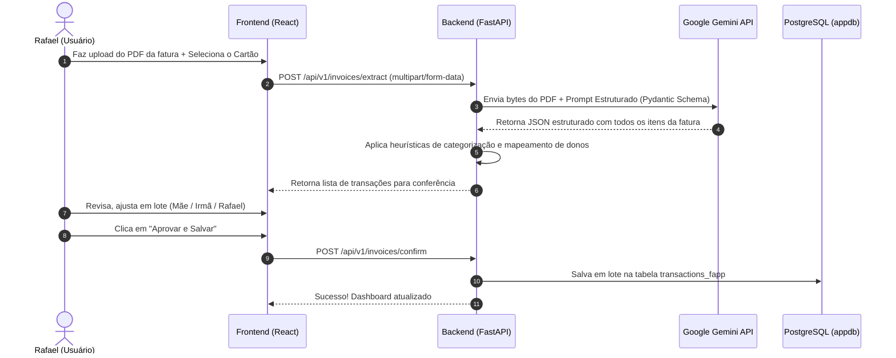

# Pipeline de Extração de Faturas PDF com Gemini API

O diferencial deste app é eliminar a digitação manual de faturas de cartão. O usuário faz upload do PDF da fatura (Nubank, Inter, Itaú, etc.), o Gemini processa o documento e entrega todos os lançamentos estruturados em segundos.

---

## ⚙️ Fluxo de Processamento



---

## 🧩 Schema Pydantic para o Gemini (Structured Output)

A chamada para a API do Gemini utilizará **Structured Outputs** nativo com tipagem garantida:

```python
from typing import List, Optional
from pydantic import BaseModel, Field

class ExtractedInvoiceItem(BaseModel):
    purchase_date: str = Field(description="Data da compra no formato AAAA-MM-DD")
    description: str = Field(description="Nome do estabelecimento comercial ou descrição da compra")
    amount: float = Field(description="Valor da transação em Reais (positivo)")
    current_installment: int = Field(default=1, description="Número da parcela atual. Exemplo: se for 02/10, retornar 2. Se for à vista, 1")
    total_installments: int = Field(default=1, description="Total de parcelas. Exemplo: se for 02/10, retornar 10. Se for à vista, 1")
    suggested_category: str = Field(description="Categoria sugerida: Mercado, Lazer, Farmacia, Alimentacao, Assinaturas, Roupas, Transporte, Outros")
    suggested_owner: Optional[str] = Field(default=None, description="Sugestão de dono caso o cartão possua cartões adicionais com nomes diferentes na fatura")

class ExtractedInvoiceResponse(BaseModel):
    bank_or_issuer: str = Field(description="Nome do banco ou emissor identificado na fatura (ex: Nubank, Inter, C6, Itau)")
    invoice_month_year: str = Field(description="Mês e ano da fatura (ex: 2026-11)")
    due_date: Optional[str] = Field(description="Data de vencimento da fatura")
    total_invoice_amount: float = Field(description="Valor total consolidado da fatura")
    items: List[ExtractedInvoiceItem] = Field(description="Lista de todas as compras detalhadas na fatura")
```

---

## 🤖 Engenharia de Prompt para o Gemini

```text
Você é um especialista contábil e de extração de dados financeiros.
Analise o arquivo PDF da fatura do cartão de crédito anexado.

Instruções:
1. Extraia cada compra realizada no período da fatura.
2. Ignore pagamentos de faturas anteriores, estornos duplicados ou linhas de juros/encargos (classifique encargos como Outros se existirem).
3. Detecte compras parceladas observando padrões como '01/03', '2/10', 'Parcela 04 de 06'.
4. Identifique se a fatura lista cartões adicionais (muitas faturas separam os gastos por nome do portador impresso no cartão adicional: ex: 'Cartão Final 1234 - NOME DA MÃE'). Se houver, popule o campo suggested_owner com o nome do portador!
5. Sugira a categoria mais adequada para cada compra.
```

---

## 💡 Heurística de Aprendizado de Dono
Com o tempo, o sistema salva um dicionário de regras:
- Se `description` contém `DROGARIA` ou `FARMACIA` → Sugere **Mãe**.
- Se `description` contém `ZARA` ou `SHEIN` → Sugere **Irmã**.
- Se `description` contém `STEAM` ou `IFOOD` → Sugere **Rafael**.
O usuário sempre tem o poder final de alterar antes de salvar.
